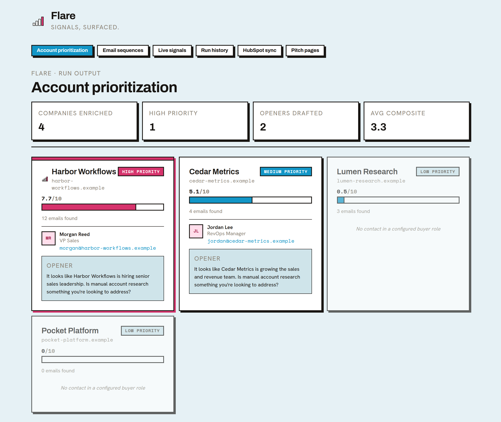
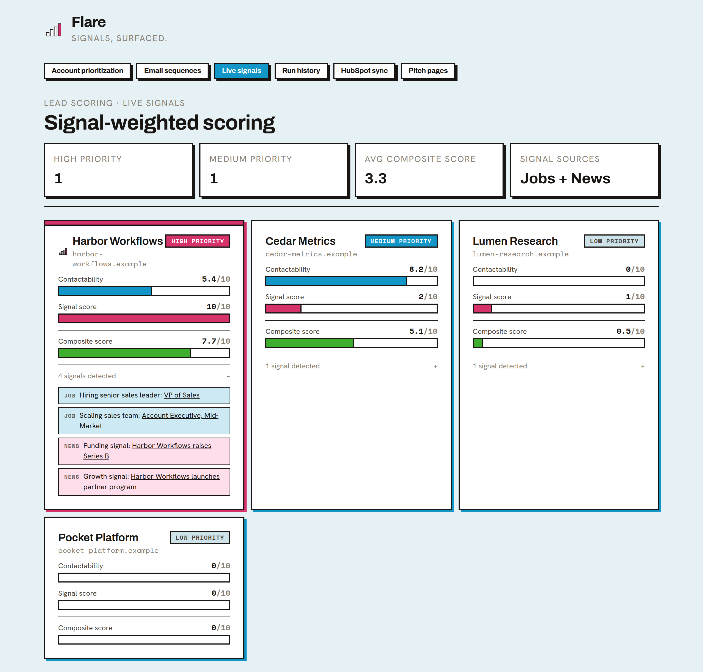
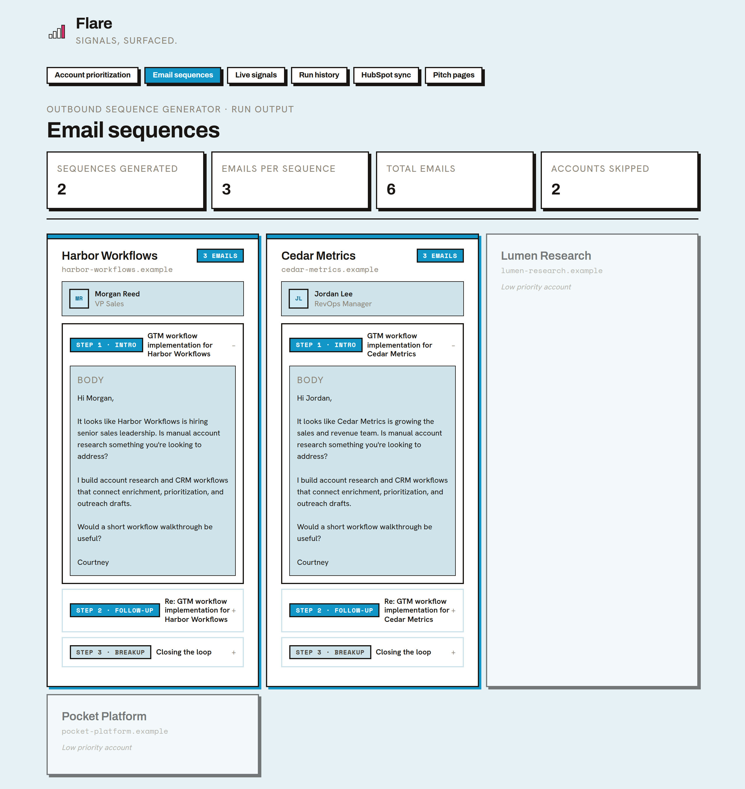
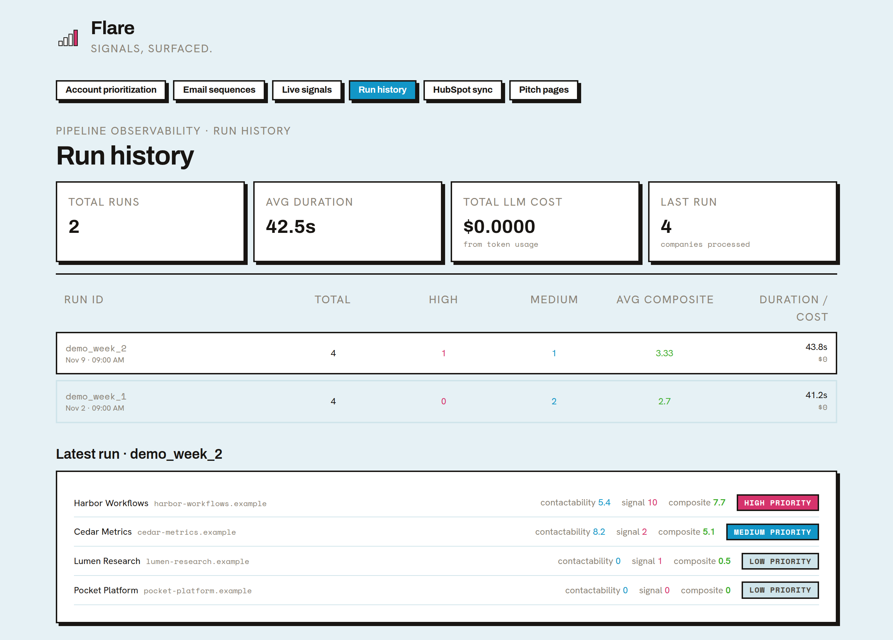

# Flare

[](https://github.com/beautifulgownss/flare/actions/workflows/ci.yml)


Flare turns a list of company domains into prioritized, evidence-backed outreach drafts.

It finds a contact in a configured buyer role, checks for hiring and news signals that can be tied to that specific account, and scores each account on two things: can we reach the right person, and is there a reason to reach out now. Openers and three-step sequences cite the signal they rely on. High-priority accounts get an LLM-generated pitch page that is only allowed to use facts from the offer, the account's signals, and an optional proof file. Accounts and contacts sync into HubSpot. Every run is logged with real token cost, run history persists between scheduled runs, and a Slack alert fires when an account's score moves.

---

## Try the offline demo (no API keys)

Requires Python 3.11+ only. No pip packages or frontend build are needed.

```bash
python src/demo.py
```

Open `demo/output/index.html` in your browser. It shows four fictional accounts,
two three-step draft sequences, and two skipped accounts with explanations.
`demo/output/results.json` contains the same run as structured data.

The demo uses `.example` domains and fictional people. Fixture search results run
through the same relevance filter, signal scoring, contactability scoring, and
template generation as a live run, including a deliberate name-collision result
that the filter drops. It never imports enrichment APIs, CRM sync, alerting, or
model integrations. Output is deterministic and stays under `demo/output`.

Optional: `python src/demo.py --campaign config/campaign.json --output /tmp/flare-demo`.
Use `--input` to supply a different JSON fixture list.

## Dashboard

Load the same fictional data into the dashboard, then start it:

```bash
python src/demo.py --dashboard
cd dashboard && npm install && npm start
```

These screenshots come from that command. Every company and person is fictional.

| Account Prioritization | Live Signals |
|---|---|
|  |  |

| Email Sequences | Run History |
|---|---|
|  |  |

Live Signals links every timing point to the result it came from. Run History shows two demo runs: the week Harbor Workflows' funding news appeared, it moved from Medium to High, which is the score change an alert would flag.

---

## The problem

Sales and marketing teams spend 30-45 minutes per account on manual research: finding the right contact, checking their email, deciding whether now is a good time, and writing outreach. Static CRM data goes stale fast, and generic "saw you're growing" openers get ignored.

Flare does that research automatically, keeps only evidence it can tie to the account, and tells you when an account becomes worth re-engaging.

---

## What it does

1. **Enriches** a CSV of domains via Hunter.io: contacts, titles, email confidence, and verification status. Domains are normalized and deduplicated.
2. **Fetches timing signals** from Serper (Google): recent job posts and news, limited to a configurable lookback window (default 3 months). A result only counts if it's on the company's domain, on an applicant-tracking board under the company's slug, or names the company's domain. Name-only matches are dropped, because names like "Linear" and "Notion" collide with unrelated results.
3. **Scores** each account 0-10 on two components:
   - **Contactability**: the highest-priority configured buyer role with a usable email, adjusted by Hunter confidence and verification. Low-confidence and invalid emails are dropped. Company size and email count don't count.
   - **Timing**: account-specific job and news signals, each kept with its source link.
   - The composite is a weighted average (default 50/50) with High / Medium / Low thresholds, all set in `config/campaign.json`. Contactability alone tops out at Medium, so High priority requires a reason to reach out now. The scoring step warns if more than half of the accounts land in High.
4. **Drafts** an opener using the selected contact and the strongest signal, phrased by category ("hiring senior sales leadership") rather than quoting a search result. With no signal, it makes no timing claim.
5. **Sequences** each account into a 3-step email sequence (intro, follow-up, breakup).
6. **Generates pitch pages** for High priority accounts with a live Anthropic call. The prompt forbids invented customers, metrics, or quotes. A proof line is only requested when `context/proof.md` exists, and it's removed from the output otherwise.
7. **Syncs to HubSpot**: Companies upserted by domain, Contacts by email, with associations.
8. **Logs every run** to SQLite with duration, per-account scores, and actual token usage and cost from the model responses.
9. **Detects score changes** against the previous run and alerts in Slack (email fallback) when an account moves 1.0+ points. Alerts never fail the run.
10. **Runs weekly** in GitHub Actions, carrying run history between runs.
11. **Tests and CI**: 59 offline Python tests plus dashboard tests, run with linting and the offline demo on every push.

---

## Architecture

```
data/input/companies.csv
        ↓
src/enrich.py                  → Hunter.io → data/enriched/companies.json
        ↓
src/signals.py                 → Serper (jobs + news), relevance filter → data/signals/signals.json
        ↓
src/score.py                   → contactability + timing → data/scored_final/companies_final.json
        ↓
src/personalize.py             → evidence-backed opener → data/enriched/personalized_companies.json
        ↓
src/sequence.py                → 3-step sequences → data/sequences/sequences.json
        ↓
src/pitch_pages.py (optional)  → Anthropic → pages/{slug}.html + data/pitch_pages_status.json (token usage)
        ↓
src/hubspot_sync.py (optional) → HubSpot Companies, upsert by domain
        ↓
src/hubspot_contacts_sync.py (optional) → HubSpot Contacts, upsert by email + association
        ↓
src/tracker.py                 → data/runs.db (with real LLM cost) + data/runs_export.json
        ↓
src/diff.py                    → compare with previous run, Slack/email alert → data/score_diff.json
        ↓
dashboard/                     → React frontend → localhost:3000

src/run_pipeline.py            → runs everything above in order with one command
src/campaign.py                → buyer roles, exclusions, offer, scoring weights and thresholds
src/http_client.py             → shared HTTP session: timeouts + retries on 429/5xx
```

---

## Tech stack

- **Python** for the pipeline (standard-library `csv`, no pandas)
- **Hunter.io** for contacts, email confidence, and verification status
- **Serper** for recent job and news results
- **Anthropic API** for pitch pages; model and per-token prices set by environment variables
- **HubSpot API** with Service Key auth, custom properties, upserts, and associations
- **SQLite** for run history and cost tracking
- **Slack incoming webhooks** for alerts, with Gmail SMTP as a fallback
- **GitHub Actions** for CI on every push and the scheduled weekly run
- **React** dashboard, six tabs
- **pytest**, **ruff**, and **Jest / React Testing Library**

---

## Configure the buyer and offer

Edit `config/campaign.json` before running the pipeline:

- `buyer_roles`: title phrases in priority order (case-insensitive substring matching).
- `excluded_roles`: title phrases that disqualify a contact, even when a buyer role matches.
- `offer`: offer name, description, problem, call to action, and sender name.
- `scoring` (optional): `weights` for contactability and timing (must sum to 1), `tiers` for the High and Medium thresholds, `min_email_confidence` (0-100), and `signal_lookback` (Google's `tbs` value, e.g. `qdr:m3` for 3 months).

To give pitch pages real social proof, add `context/proof.md` with results you can back up. Without it, pitch pages contain no proof claims.

The default is an illustrative GTM workflow service, not a validated commercial offer.
Use `GTM_CAMPAIGN_CONFIG=/path/to/campaign.json` to select a different client config.
Invalid configuration fails before scoring. Contacts need an email; emails Hunter marks
invalid or below `min_email_confidence` are skipped. Outreach carries the offer snapshot
from personalization into sequence generation.

## Running the pipeline locally

**1. Clone and set up the environment**

```bash
git clone https://github.com/beautifulgownss/flare
cd flare
python3 -m venv venv
source venv/bin/activate
pip install -r requirements-dev.txt   # or: make install
```

Run `make help` to see shortcuts for the commands below.

**2. Add your API keys**

```bash
cp .env.example .env
```

Fill in your keys:

See `.env.example` for every variable. Only `HUNTER_API_KEY` and `SERPER_API_KEY` are
required; pitch pages, HubSpot, and alerts are skipped when their keys are missing.
Set `ANTHROPIC_INPUT_COST_PER_MTOK` and `ANTHROPIC_OUTPUT_COST_PER_MTOK` to your
model's current price so the run log reports accurate cost.

**3. Add your target companies**

Edit `data/input/companies.csv`:

```csv
domain
stripe.com
notion.so
your-target.com
```

**4. (First-time HubSpot setup only) Create custom properties**

```bash
python3 src/hubspot_setup_properties.py
```

This creates the `composite_score`, `gtm_recommendation`, `best_contact_email`, and `best_contact_name` custom fields on the HubSpot Company object. Only needs to run once per HubSpot account.

**5. Run the full pipeline, one command**

```bash
python3 src/run_pipeline.py
```

This runs every step in order, logs the run, checks for score changes against the previous run, and copies outputs into the dashboard.

**6. Launch the dashboard**

```bash
cd dashboard && npm start
```

Open `localhost:3000`.

**7. Run the tests and linter**

```bash
make lint test        # ruff + pytest
make dashboard-test   # React tests
```

---

## CI / Scheduled runs

Two GitHub Actions workflows:

- **`ci.yml`** runs on every push and pull request. It lints with ruff, runs the pytest suite, runs the offline demo as a smoke test (the report is uploaded as an artifact), then runs the dashboard tests and production build. It needs no secrets.
- **`pipeline.yml`** runs the live pipeline every Monday at 9am UTC. It restores `data/runs.db` from the previous run's `run-history` artifact and saves it again afterward (90-day retention), so score diffs and run history build up across runs.

To trigger manually: **Actions** → **Flare Pipeline** → **Run workflow**.

Required GitHub secrets:

| Secret | Description |
|--------|-------------|
| `HUNTER_API_KEY` | Hunter.io API key |
| `SERPER_API_KEY` | Serper.dev API key |
| `ANTHROPIC_API_KEY` | Anthropic API key (pitch page generation; step is skipped on failure) |
| `HUBSPOT_SERVICE_KEY` | HubSpot Service Key (Settings → Integrations → Service Keys) |
| `SLACK_WEBHOOK_URL` | Slack incoming webhook for score alerts (optional) |
| `ALERT_EMAIL_SENDER` | Gmail address for fallback email alerts (optional) |
| `ALERT_EMAIL_PASSWORD` | Gmail App Password (optional) |
| `ALERT_EMAIL_RECIPIENT` | Where fallback email alerts go (optional) |

Optionally set the `ANTHROPIC_MODEL` repository variable to choose the pitch-page model.

Only run summaries (run export, score diff, sync and pitch status) are uploaded as artifacts, kept 14 days. Enriched contacts, sequences, and pitch pages contain personal data, so they are not uploaded.

---

## HubSpot CRM sync

Every pipeline run pushes the final scored accounts, and their best contact, into HubSpot as real, linked CRM records. Not just JSON files sitting in a repo.

**Companies (`hubspot_sync.py`)**
- Authenticates via a HubSpot Service Key, HubSpot's current recommended pattern for system-to-system API access (replacing legacy private apps)
- Searches for an existing Company by domain before writing. Creates a new record if none exists, updates the existing one if it does, so repeated runs don't create duplicates
- Maps composite score, final recommendation, and best contact (name + email) onto custom Company properties you can see and filter on directly in HubSpot
- Writes a status report (`data/hubspot_sync_status.json`) on every run: per-account success/failure, action taken, duration

**Contacts (`hubspot_contacts_sync.py`)**
- Searches for an existing Contact by email before writing, same idempotent pattern as Companies, just keyed on email instead of domain
- Creates or updates the Contact's name and job title
- Associates the Contact to its parent Company through HubSpot's v4 associations API, so it's an actual relationship in the CRM, not two records that just happen to reference the same company

**Why the sync is non-fatal:** both HubSpot steps run as non-blocking in `run_pipeline.py`. If a sync fails (rate limit, auth hiccup, whatever), the rest of the pipeline still finishes. Scoring and the dashboard shouldn't go down because a third-party API had a bad moment.

**Dashboard visibility:** the "HubSpot Sync" tab shows last sync time, total/succeeded/failed counts, and a row per account with action taken, duration, and status. Pulled straight from the same status file the sync script writes.

---

## Score alerts

After each run is logged, `diff.py` compares composite scores with the previous run. When an account moves 1.0+ points, or a new account appears, it posts to Slack with the old and new score and any tier change. If Slack isn't configured or the post fails, it falls back to an HTML email. Alerts are informational and never fail the run.

---

## Testing

```bash
make test             # or: python -m pytest
```

The suite runs offline in well under a second. No API keys, network, or filesystem fixtures beyond temp dirs.

**What's covered:**
- **Campaign config**: validation of roles, offer, weights, thresholds, and email-confidence limits
- **Contactability**: role priority, email confidence, verification, dropped low-confidence and invalid emails, and email count no longer inflating the score
- **Composite scoring**: configurable weights and tiers, and contactability alone never reaching High
- **Signal relevance**: the real "Linear Ad Sales jobs in New York" false positive is filtered out, generic careers pages score 0, ATS boards need the company slug, queries contain no hard-coded years
- **Signal scoring**: keyword tiers, caps, deduplication by link, whole-word matching for acronyms
- **Outreach drafts**: openers use the signal category rather than the raw headline, make no timing claim without evidence, and never invent emails
- **Pitch pages**: no proof block or proof line without `context/proof.md`, unsupported proof lines dropped, token cost from real usage
- **Run history**: real cost logged, schema migrations on older databases
- **Score diffs and alerts**: the inclusive ±1.0 threshold, new-account alerts, Slack first with email fallback, and alerts never exiting
- **Orchestration**: signals run before scoring, optional steps run last and never stop the run
- **HTTP client**: default timeouts and retry policy
- **Offline demo**: end-to-end with sockets patched to fail; output is deterministic
- **Dashboard**: renders every tab without crashing on empty data

Scoring and signal logic are pure functions separated from I/O, so they're tested directly instead of through mocked APIs.

---

## Sample output

From the offline demo (fictional accounts):

| Account | Contactability | Timing | Composite | Tier | Why |
|---------|---------------|--------|-----------|------|-----|
| Harbor Workflows | 5.4 | 10.0 | 7.7 | High | VP Sales reachable; hiring a VP of Sales, recent Series B |
| Cedar Metrics | 8.2 | 2.0 | 5.1 | Medium | RevOps Manager reachable; hiring in RevOps. An unrelated "Linear TV" job was filtered out |
| Lumen Research | 0.0 | 1.0 | 0.5 | Low | Only contact is in an excluded role |
| Pocket Platform | 0.0 | 0.0 | 0.0 | Low | No contacts found |

### Email sequences

Each high-priority account gets a 3-step sequence:

| Step | Type | Purpose |
|------|------|---------|
| 1 | Intro | Personalized first touch referencing company-specific context |
| 2 | Follow-up | Adds a new insight or angle, doesn't just bump the thread |
| 3 | Breakup | Closes the loop gracefully, leaves the door open |

### Run history

Every pipeline run is logged automatically:

| Field | Description |
|-------|-------------|
| Run ID | Unique timestamped identifier |
| Duration | End-to-end pipeline execution time |
| Companies processed | Account count per run |
| High / Medium / Low | Priority distribution |
| Avg composite score | Mean signal-weighted score across accounts |
| LLM tokens and cost | Actual input/output tokens from model responses, priced at the configured rates |
| Score alerts | Accounts with ±1.0+ composite score change vs prior run |

### HubSpot sync status

Every sync attempt is logged automatically:

| Field | Description |
|-------|-------------|
| Last synced | Timestamp of the most recent sync attempt |
| Total / Succeeded / Failed | Per-run sync outcome counts |
| Per-account action | Created vs. updated, with duration in milliseconds |
| Per-account error | Raw HubSpot error response, when a sync fails |

---

## Key engineering decisions

**Single-command orchestration.** `run_pipeline.py` runs a declarative list of steps, each marked required or optional, then logs the run and copies outputs to the dashboard. It resolves paths from the repo root, so it works from any directory.

**Resilient API calls.** Every third-party request goes through one shared session (`http_client.py`) with a 20s default timeout and exponential-backoff retries on 429/5xx that honor `Retry-After`. A hung connection can't stall the scheduled run, and a rate-limit blip doesn't fail it.

**Waterfall enrichment thinking.** Hunter.io returns strong contact data but limited firmographics. A production version would stack a second API (People Data Labs, Clearbit) to fill gaps like industry and employee count.

**Configured buyer roles.** Campaign buyer roles are ordered by priority. A matching contact with an enriched email qualifies; exclusions override matches. No matching contact means outreach is skipped. Scoring measures role availability and email coverage, not firmographic fit.

**Two-part scoring with evidence.** Reaching the right buyer and having a reason to reach out now are scored separately and combined 50/50 by default. The earlier version scored contact availability and email volume, which put 4 of 5 accounts in High priority. Now High requires both, and every timing point links to the result it came from.

**Relevance before scoring.** A search result counts only if it can be tied to the account's domain. An earlier run counted "Linear Ad Sales jobs in New York" as a hiring signal for Linear and treated a generic careers page as a senior sales hire. Both cases are now regression tests.

**Score change alerting.** `diff.py` runs inside the pipeline after the run is logged and posts to Slack when an account shifts ±1.0+. Run history is persisted between scheduled runs, so there is always a previous run to compare against.

**CRM sync as a non-fatal step.** Both `hubspot_sync.py` and `hubspot_contacts_sync.py` are wired in but never block the rest of the pipeline if they fail. Internal scoring and dashboard data are the source of truth. CRM sync is a downstream consumer of that, not a dependency for it.

**Upsert by stable identifier, not display name.** Company names vary in formatting ("Stripe" vs "Stripe, Inc."), and people's display names aren't unique. Companies get upserted by domain, Contacts by email, both stable and unique, so syncs stay idempotent across repeated runs.

**Real associations, not just co-located records.** The Contacts sync calls HubSpot's associations API to actually link each Contact to its Company. Two records that happen to reference the same domain aren't a CRM relationship. An association is.

**Sync observability as a first-class output.** `hubspot_sync.py` writes a status file on every run, surfaced right in the dashboard. You can see sync health instead of finding out about it when a rep complains a record's missing.

**Reviewable drafts over unverified generation.** Openers and sequences are deterministic templates built from the enriched contact, the configured offer, and the strongest account-specific signal, flagged `requires_review`. LLM generation for these is held back until an eval set exists to measure it.

**No invented proof.** The pitch-page prompt only allows facts from the offer, the account's signals, and `context/proof.md`. Without a proof file, the prompt asks for no proof and any proof line the model returns is removed.

**Sequence coherence.** Each follow-up email is aware of the previous step's angle, adding new information instead of restating the opener. Mirrors how a skilled SDR actually runs a sequence.

**Deterministic slugs, not model-trusted filenames.** Pitch page filenames are computed by slugifying the company name in code, never taken from the model's own `company_slug` field. Model output is untrusted text, and letting it become a path component is a filesystem risk, not just a style choice.

**Signal-grounded generation.** Every value prop in a pitch page must cite the specific enrichment signal it's built on, enforced directly in the prompt's JSON schema. Keeps the copy tied to real account data instead of generic marketing filler.

**Observable by default.** Every run is persisted to SQLite with per-account score breakdowns, duration, and token cost calculated from the model's reported usage.

**Testing the logic, not the I/O, first.** Relevance filtering, signal scoring, and account scoring are pure functions separated from API calls and file I/O, so they're tested directly.

---

## Roadmap

- [ ] ICP-fit scoring from firmographics, with the evidence behind each point
- [ ] A labeled eval set for signal relevance and draft quality, run in CI
- [ ] LLM-written drafts with an approval queue
- [ ] Hosted demo on fictional data
- [ ] Integration tests for the HubSpot sync scripts with a mocked API client
- [ ] Warehouse mode (DuckDB / dbt) as an alternative to CSV input
